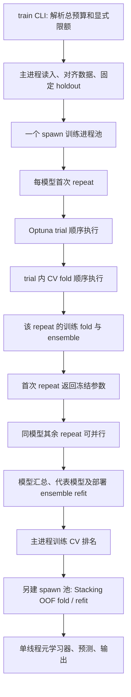
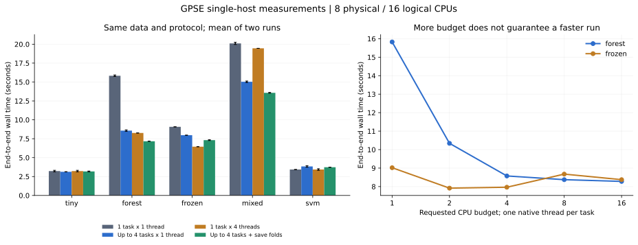
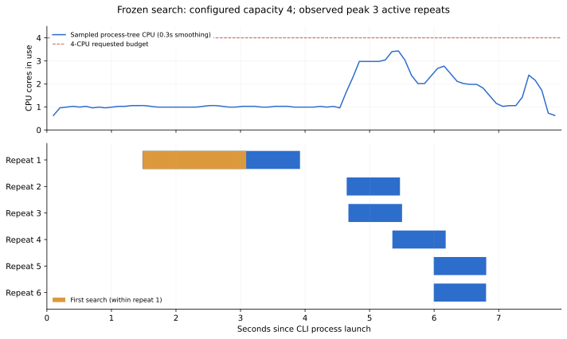

# GPSE 单服务器线程与进程调度研究

> 本报告保留的是下述源码哈希对应的优化前测量快照。后续的改动及前后对照见 [fold 预测复用](fold-prediction-reuse.md)和 [fold 级并行调度](fold-parallel-scheduling.md)；历史数据没有覆盖为新结果。

研究日期：2026-10-23。研究对象是本地工作树，基准提交为 `a240260`，包含研究开始前就存在的共享池、Stacking 并行和进程清理改动。不能用提交中的旧实现代替当前工作树来解释现象。本轮只新增研究脚本、测量记录和报告，没有修改训练算法、调度器或现有配置。

## 1. 结论

当前软件确实能同时使用多个 CPU，但**配置的线程预算、实际同时训练的任务数、真正消耗的 CPU 时间是三件事**。主要限制是首次参数搜索的顺序依赖、任务粒度过粗、进程启动与数据复制，以及一部分模型本身不支持拟合时多线程。还发现默认路径有重复拟合，增加核数无法消除这部分工作。

目前最值得先处理的问题：

1. **减少重复计算。** `save_models=False` 时，每个 repeat 的 K 个模型训练完后被丢弃；ensemble 预测阶段再拟合 K 次。`--save_models` 能避免这轮重训，但以额外磁盘读写换计算，不宜作为最终架构。
2. **让首次搜索和剩余任务能使用空闲预算。** 单个 Optuna study 的 trial 串行，trial 内的 CV fold 串行；默认冻结超参数时，同模型后续 repeat 等待首次 repeat 整体完成。共享池只能调度已经满足依赖的任务。
3. **根据模型、阶段和任务大小分配预算。** 小任务启动多进程几乎没有耗时收益；随机森林内部并行有效，SVC 等算法不能靠提高 `n_jobs` 获得相同效果。
4. **控制数据复制和内存。** 当前 spawn worker 各接收一份完整 X/y；CPU 预算没有附带内存准入。大 SNP 矩阵上的最佳 worker 数可能远小于逻辑 CPU 数。
5. **检查批处理外层限额。** 仓库的自适应 launcher 示例默认只允许 2 个性状，每性状 8 个 CPU 预算。即使总预算写成 90，也只有至多 16 个训练预算单元；示例还显式设置 `repeat_workers: 1`。

## 2. 实测范围与方法

### 环境

- 当前可见机器：AMD Ryzen 7 8845HS，8 个物理核、16 个逻辑 CPU，单 NUMA 节点；内存约 93 GiB。
- `get_available_cpu_cores()` 在本环境返回 16，affinity 为 CPU 0–15。本环境没有可读的根 `cpu.max`；不能据此推断生产服务器没有 cgroup 限制。
- Python：`/home/zj/.pyenv/versions/gpse/bin/python`。项目 `.python-version` 指向的 `gpse_new` 在本次检查时缺少 NumPy、pandas、sklearn 等依赖，因此没有使用它测训练，也没有改动环境配置。
- NumPy 2.2.6、pandas 2.3.3、scikit-learn 1.7.2、Optuna 4.9.0；其余版本与生产源码 SHA-256 见测量 JSON。
- 没有收到实际慢任务的命令和服务器数据。本报告完成当前实现的单机研究，数字仅代表这台机器上的指定合成负载；尚不能给真实高维数据下的最佳并发数。

### 采集口径

研究脚本为 [profile_single_server.py](../scripts/profile_single_server.py)。每组独立启动真实训练 CLI，组间串行执行；每个配置测两次，第二次反转配置顺序。端到端耗时包含导入、数据读取、训练、保存、报告与进程退出。两次测量足以检验这里较大的差异，不构成跨机器的统计置信区间。

CPU 时间取父测试进程 `RUSAGE_CHILDREN` 的增量，包含被训练 CLI 回收的 worker；`平均使用核数 = CPU秒 / 墙钟秒`。例如平均 2.24 核等于约 224% 的 Linux 单核口径，约占本机 16 个逻辑 CPU 的 14%。这不是“配置了几个线程”。

另外每约 100 ms 采集一次该训练进程树的 `/proc/<pid>/stat`，记录 CPU 时间、进程数、驻留线程数和 RSS。RSS 为进程 RSS 相加，重复计算共享页，**不是 PSS，也不等于实际独占物理内存**；这里用于同一口径下比较。轮询带来的耗时分辨率约为 0.1 秒。短暂线程和 CPU 峰值可能漏采，因此不宣称测得了严格的瞬时资源上界。

任务并发从 `logs/events.jsonl` 的实际 repeat/Stacking 开始与结束事件重建，不用队列中 future 数替代。阶段耗时存在包含关系，不能把 trial、fold、repeat、model 的时间直接相加。

### 负载

所有 X 为固定种子的 0/1/2 剂量矩阵，标签来自三个 SNP 的线性信号加噪声；分类标签按中位数二分。默认不做额外特征筛选。

| 负载 | 样本 × SNP | 模型 | repeat / fold / trial | 目的 |
| --- | --- | --- | --- | --- |
| tiny | 80 × 24 | Lasso、KernelRidge | 4 / 2 / 跳过搜索 | 小任务与进程启动成本，包含 Stacking |
| forest | 1000 × 192 | RandomForest | 8 / 3 / 跳过搜索 | 较重训练、任务并行与内部并行 |
| frozen | 700 × 128 | RandomForest | 6 / 3 / 6 | 冻结 Optuna 参数的首次搜索屏障 |
| mixed | 700 × 128 | RandomForest、GBDT、LightGBM | 4 / 3 / 每模型 4 | 不同模型混合与 Stacking |
| svm | 800 × 128 | SVC，probability=True | 4 / 3 / 跳过搜索 | 内部线程不敏感的算法 |

为了限制审计成本，森林默认配置固定为 80 棵树、深度 8、max_features=0.5；搜索将树数限制为 60/80、深度限制为 4–8，其余 min_samples_split、min_samples_leaf、bootstrap 等搜索项通过现有的按名字合并规则保留。其余模型使用当前注册表。跳过搜索的组用来隔离调度成本，并非建议正式分析关闭参数优化。只有至少两个成功模型时，当前流水线才实际执行 Stacking。

## 3. 当前调用链与 CPU 预算



### CLI 的两种预算推导，都进入共享池

定位：`gpse/train/cli.py::_apply_threads_budget`、`main`，`gpse/train/_pipeline.py::run_all_models`，`gpse/train/_scheduler.py::run_budgeted_models`。

无显式旧参数时默认自动预算，或通过 `--threads N/auto/-1` 指定。自动推导大致为：

```text
n_jobs = max(1, budget // min(budget, model_count * n_repeats))
slots = budget // n_jobs
max_workers = min(model_count, slots)       # 未显式设置时
repeat_workers = min(n_repeats, slots)     # 未显式设置时

pool_capacity = min(
    budget // n_jobs,
    min(model_count, max_workers) * min(n_repeats, repeat_workers)
)
```

如果未提供 `--threads`，但显式提供 `--n_jobs`、`--max_workers` 或 `--repeat_workers`，先校验这些值的乘积；CLI 随后仍将该乘积作为 `cpu_budget` 传给 predictor，因此同样进入共享池。**不能把这个 CLI 模式误称为传统嵌套池。** 本报告中的 `serial` 指三个旧参数全为 1 的 CLI 基线；它仍有一个训练 worker，与 `shared1` 基本等价，并不是无子进程的 Python API。

几个容易导致“只用了少数核心”的配置：

- 只给 `--n_jobs 1`，没有 `--threads`：自动预算被关闭，默认 worker 仍是 1，总预算为 1。
- `--threads 16 --n_jobs 1 --repeat_workers 1`，只选一个模型：同时只有一个 repeat。
- 单模型、2 个 repeat，预算 80：自动算法可能给每任务 40 个内部线程；对不支持这种内部并行的模型，大部分预算无法转化为计算。
- 显式的 `1` 也会保留，包括 YAML 传下来的 `max_workers`、`repeat_workers`。不能仅从 `--threads` 推断会用满预算。

### Python API 另有传统路径

直接构造 `GenomicPredictorV2` 时，`cpu_budget` 默认 None；`max_parallel_jobs`、`repeat_workers` 默认各为 1，**不会像 CLI 一样自动展开**。此路径保留模型池、模型内部 repeat 池，可能嵌套，也不会通过 CLI 的总乘积校验。即便 API 设置 `cpu_budget=N`，它也只限制共享池容量，不自动把默认两个 worker 参数改大。

### 池里排队并不代表 CPU 忙碌

`futures` 的数量包含等待启动和排队的任务。scheduler 只限制任务和配置的内部线程预算，不是操作系统 CPU quota；它没有给每个 worker 绑定独占核，也不能把任意第三方库的所有线程活动都变成硬性上界。native pool 配置在 worker 启动时发布，但可选库可能稍后才加载；不能只凭 ready 事件证明全部拟合阶段的第三方线程行为。

## 4. 性能对比

### 相同负载，两次运行的端到端平均秒数

| 负载 | serial / 1 核预算 | shared1 | shared4：4 个任务、每任务 1 线程 | inner4：1 个任务、内部 4 线程 | save4：shared4 加保存 fold 模型 |
| --- | ---: | ---: | ---: | ---: | ---: |
| tiny | 3.22 | 3.22 | 3.13 | 3.22 | 3.18 |
| forest | 15.83 | 15.83 | 8.57 | 8.26 | 7.17 |
| frozen | 9.07 | 9.02 | 7.96 | 6.45 | 7.31 |
| mixed | 20.11 | 19.86 | 15.03 | 19.45 | 13.57 |
| svm | 3.43 | 3.43 | 3.83 | 3.43 | 3.73 |

这些差异揭示了几种不同机制：

- forest 的 shared4 比 serial 快约 1.85 倍；内部并行也有效，且 RSS 合计更低。并不存在“进程越多一定越快”。
- frozen 的 shared4 只有约 1.14 倍加速，内部 4 线程约 1.41 倍；首次搜索期间无法并行后续 repeat。
- mixed 的 shared4 优于 inner4：后者整个共享池只剩一个任务，GBDT 等模型又不能充分使用内部四线程。
- tiny 的 shared4 平均用了约 2.90 核，而 serial 约 0.99 核，耗时却几乎相同。CPU 更忙，主要没有转化为训练加速。
- 本组 SVC 的计算太短，shared4 反而慢约 12%。不能从它推断大型 SVC repeat 并行无效；它证明这组任务尚不能摊薄启动成本。

### 内存与实际任务并发

| 负载 | serial RSS 合计 MiB | shared4 RSS 合计 MiB | inner4 RSS 合计 MiB | shared4 实测 repeat 并发峰值 |
| --- | ---: | ---: | ---: | ---: |
| tiny | 403 | 979 | 403 | 4 |
| forest | 420 | 1036 | 427 | 4 |
| frozen | 410 | 1004 | 412 | 3 |
| mixed | 447 | 1069 | 446 | 4 |
| svm | 411 | 810 | 411 | 2 |

forest 的 shared4 端到端平均约使用 2.24 核，inner4 约 2.28 核。serial 配置也观察到约 10 个驻留 OS 线程，但平均仅消耗 1 核；inner4 约 29 个驻留线程，仍没有一直使用 4 核。这再次说明不能把线程数当利用率。

### 扩展到 8/16 个预算单元并没有继续线性加速

| 配置 | forest 秒 / 平均核数 | frozen 秒 / 平均核数 | 说明 |
| --- | ---: | ---: | --- |
| shared2 | 10.34 / 1.66 | 7.91 / 1.29 | 预算 2，每任务 1 线程 |
| shared4 | 8.57 / 2.24 | 7.96 / 1.51 | 预算 4，每任务 1 线程 |
| shared8 | 8.37 / 2.56 | 8.67 / 1.52 | 预算 8，每任务 1 线程 |
| shared16 | 8.28 / 2.59 | 8.37 / 1.51 | 预算 16，每任务 1 线程 |
| auto | 7.46 / 3.33 | 7.15 / 1.99 | 本机预算 16，自动分配每任务 2 线程 |
| hybrid8 | 7.21 / 3.13 | 7.16 / 1.99 | 预算 8，每任务 2 线程，最多 4 个任务 |
| cap1 | 15.83 / 1.00 | 9.12 / 1.00 | 预算 4，显式 repeat_workers=1，内部 1 线程 |

forest 总共 8 个 repeat，shared16 的池容量仍只有 8；frozen 的 6 个 repeat 对应容量至多 6。这个限制来自实际任务数。冻结搜索组的 shared8/shared16 甚至比 shared2 更慢。auto 消耗更多 CPU 后有所加速，但仍不是此负载耗时最低的配置。8 个预算单元的混合分配在 forest 中用约 7.21 秒、RSS 合计约 1045 MiB；auto 约 7.46 秒、约 1446 MiB。差异较小，应在实际服务器上增加重复测量后再选最优值。




## 5. 首次搜索为何会空闲

`_optimization.py` 将 Optuna `n_jobs` 固定为 `ModelConstants.optuna_n_jobs=1`。objective 内用普通 for 循环逐个拟合 CV fold。`_scheduler.py` 在冻结参数缓存尚未返回且已有活动 repeat 时，拒绝给同模型再提交 repeat；缓存只在第一次完整 repeat 返回后设置，搜索结束后还要等该 repeat 的 CV、ensemble、JSON 输出。

因此单模型初次搜索时，最多只有一个训练任务，其 CPU 能力主要取决于该估计器内部并行。假设 128 CPU 的服务器上同时只有 15 个模型的首次搜索，而且每任务只有 1 线程，搜索阶段通常只有至多 15 个这类任务，不会因为总预算 128 就自动产生 128 个独立任务。这是当前任务依赖的推导，并非本机上的 128 核实测。

在 frozen/shared4 的第一次运行中，首次 repeat 从 CLI 启动后 1.48 秒开始，到 3.92 秒结束；其中搜索约 1.60 秒。第二个及之后 repeat 最早在 4.65 秒开始。虽然配置容量为 4，该次运行实测最多只有 3 个 repeat 同时进行，整个 repeat 区间的平均活动任务数约 1.23。后续 worker 的导入和启动也在消耗 CPU，CPU 曲线与有用训练的并发不能混为一谈。




另外，虽然配置了 MedianPruner，当前训练代码没有调用 `trial.report()` 或 `trial.should_prune()`。因此它没有提供中间分数驱动的 median 剪枝；显式 `TrialPruned` 用于无效 fold，study 另有 trial 级停止回调。不能把配置了 pruner 理解成已经省掉了表现差的模型训练。

优先考虑**同一 trial 内 fold 并行**，保持 trial 采样顺序和 fold 分数按原顺序汇总；它能处理首次搜索的空闲。不能直接将 Optuna `n_jobs` 改成核数：Optuna 4.9 的此参数使用线程，并行采样还会改变搜索的可复现性。[Optuna 4.9 optimize 文档](https://optuna.readthedocs.io/en/v4.9.0/reference/generated/optuna.study.Study.html#optuna.study.Study.optimize)、[可复现性说明](https://optuna.readthedocs.io/en/v4.9.0/faq.html#how-can-i-obtain-reproducible-optimization-results)。

这项建议仍需设计全局任务依赖和预算，不能在已经占满的 repeat worker 内再各建一个不限额的 fold 池。

## 6. 默认路径的重复拟合与额外工作

定位：`_repeat_training.py::train_and_evaluate_model_for_repeat`、`_ensemble.py::_compute_ensemble_predictions`、`_save_deployment_ensemble`、`config/_topsis_config.py::_save_representative_model`。

单模型成功执行时，设 R 为 repeat 数、K 为训练 fold 数、Q 为冻结搜索实际 trial 数，S 为该模型被选入 Stacking 后的 OOF fold 数：

```text
不保存 fold 模型： Q*K + 2*R*K + 1 + K + (被选入 Stacking 时的 S+1)
保存 fold 模型：   Q*K +   R*K + 1 + K + (被选入 Stacking 时的 S+1)
```

这里假设 Q 个 trial 都完整执行 K 个 fold；无效 trial 可能提前退出，此时应将 `Q*K` 替换成实际搜索拟合次数。`1` 是代表模型重拟合，额外 `K` 是部署 ensemble 重拟合。它们当前没有被 `save_models=False` 关闭；`save_representative` 参数虽然存在，代表模型保存函数也没有据此跳过拟合。Stacking 还需至少两个成功模型才执行。逐 repeat 重新优化时，将 `Q*K` 换成所有 repeat 实际 trial 工作量之和。

使用真实 Python API 的无训练子进程路径，对同一数据用 cProfile 直接计数 `sklearn/ensemble/_forest.py::fit`。参数 R=4、K=2，同时训练 RF 和 Lasso，Stacking OOF=2，因此 RF 的 Stacking 部分有 3 次拟合。未启用 `save_representative`，仍观察到代表模型重拟合。

| 搜索 | 保存 fold 模型 | 搜索实际 fit 次数 | RF 总 fit 次数 |
| --- | --- | ---: | ---: |
| 默认参数 | 否 | 0 | 22 |
| 默认参数 | 是 | 0 | 14 |
| 冻结 Optuna | 否 | 3 | 25 |
| 冻结 Optuna | 是 | 3 | 17 |

两种搜索设置中，保存 fold 模型都精确少了 8 次拟合，即 R×K。小数据审计的第 2 个 RF trial 在第 1 个 fold 因常量预测被裁剪，所以两个 trial 实际只有 3 次搜索拟合，而非 4 次；计数已经按真实执行修正。此处 cProfile 用于调用次数，不参与前面的性能计时。


默认 CLI 的 R=50、K=5、trial 上限 100。如果实际跑满 100 个 trial，每个非固定模型在进入 Stacking 前，就有 `500 + 500 + 1 + 5 = 1006` 次估计器拟合；保存 fold 模型时为 756 次。这里包括有科学用途的搜索和独立 refit，**并非所有额外拟合都应删除**；应先消除已经拟合过、只为 ensemble 预测再次训练的那部分。

此外，imputer、selector、scaler 都在训练 partition 内拟合，这是避免标签泄漏的必要边界。当前每个 trial/fold 会重复执行这条预处理流水线。后续缓存应以固定 fold、筛选配置和数据版本为键，只在同一训练划分内复用；不能在完整数据上先拟合筛选器再 CV。

## 7. 各模型对线程的响应不同

`models.yaml` 的 thread_strategy 决定是否注入构造参数；`thread_strategy: none` 只表示没有对应的构造参数，**不代表任何阶段都绝不会使用 BLAS 线程**。

| 模型组 | 当前控制 | 调参含义 |
| --- | --- | --- |
| RF 回归/分类、KNN | 注入 n_jobs | RF 可并行树；KNN 的 fit 往往很轻，代价更多在邻居查询/预测 |
| XGBoost 回归/分类 | 注入 n_jobs、nthread | 模型内部可并行，须与外层任务数共同限制 |
| LightGBM 回归/分类 | 注入 n_jobs | 内部 OpenMP 并行，小数据也可能被调度成本抵消 |
| CatBoost 回归/分类 | 注入 thread_count | 使用自己的线程配置；不能仅用 BLAS ready 记录评估 |
| HistGradientBoosting | 无构造线程参数；依赖 OpenMP 限制 | 增加 n_jobs 在 GPSE 中是调整 native 限制，不是给估计器注入 n_jobs |
| MLP 回归/分类 | 无构造线程参数；数值运算可用 BLAS | 是否有效取决于矩阵大小与 solver |
| KernelRidge、GBLUP | BLAS；SafeKernelRidge 将 scipy.linalg.solve 固定为 1 线程 | kernel 构建可并行，但线性求解不能靠增加线程突破当前保护 |
| Lasso、ElasticNet、SGD、LinearSVR、GBDT、AdaBoost、SVC | 当前没有 fit 级 n_jobs 注入 | 主要依靠独立模型/repeat/fold 并行；部分辅助计算可使用数值库 |

scikit-learn 的 joblib 并行、OpenMP 并行和 BLAS 并行是不同层次；`n_jobs` 不是对三者统一的调度器。[scikit-learn 1.7 并行文档](https://scikit-learn.org/1.7/computing/parallelism.html)。当前 GPSE 通过环境变量、估计器参数和 `threadpool_limits` 分别控制它们。

`_feature_selection.py` 中 ExtraTrees、LassoCV、ElasticNetCV、LogisticRegressionCV 的 n_jobs 固定为 1；单个大筛选任务也可能受此限制。互信息筛选未传并发数。若实际慢日志停在特征筛选，增加 RF 的线程没有直接解决该阶段。

不要直接把进程池换成线程池：repeat 调用全局 `np.random.seed()`，SafeKernelRidge 在拟合时临时替换 `scipy.linalg.solve`，native 线程池限制也涉及进程全局状态。同一进程并发拟合需要先清理这些共享状态；当前 spawn 的安全性不能因启动成本大就被忽略。[threadpoolctl 官方说明](https://github.com/joblib/threadpoolctl)。

## 8. 数据、内存、I/O 与外层批处理

### 数据搬运

训练池 initializer 的 initargs 包含 predictor、完整 X/y、CV 元数据；spawn 需要逐 worker 序列化并重新构造。当前不是只读 memmap/共享内存数据面。每个 repeat 又用 `.iloc` 生成 train/test/fold 数据，预处理产生额外数组。Stacking 另起一个池，再次传递数据。

主进程 `_ALIGNED_DATA_CACHE` 也保留对齐数据副本。对于密集 float64 数据，1000 样本 × 100000 SNP 单份约 0.8 GB，64 份就是约 51 GB，尚未包括父进程、fold 切片、模型和中间数组；实际 dtype、DataFrame 管理成本及共享页会改变数值。二进制 convert 输出可使用 int8，但进入不同模型和预处理后仍可能发生转换。

后续应先做节点内只读矩阵共享、任务只传索引和配置、限制在途任务，并按实测内存准入。不能认为 joblib 在某些估计器内部的自动 memmap，会自动共享当前 GPSE 自己的 ProcessPoolExecutor 的 X/y。[scikit-learn 1.7 资源说明](https://scikit-learn.org/1.7/computing/parallelism.html)。

### 日志与保存

每个 worker 写独立日志和 producer JSONL，主进程轮询并合并事件；另有预测 CSV、结果 JSON 和模型文件。当前测试使用本地文件系统，未测 NFS、共享存储、页缓存冷启动和大量 SNP 的输出压力。CPU 空闲也可能是在等序列化或磁盘。启用 `--save_models` 的本次收益成立，但大量大模型或网络盘上可能有不同结果。

### batch 与自适应调度器

- `gpse batch` 在 `batch/runner.py::run_batch` 中按性状 for 循环运行，同一时刻通常只训练一个性状；“batch”不等于性状之间并行。
- `gpse.batch.adaptive_scheduler` 才会同时启动多个性状，各性状内部再分预算。
- `batch/launch_lowdim_adaptive.sh` 默认 `MAX_THREADS=90`、`THREADS_PER_TRAIT=8`、`MAX_CONCURRENT_TRAITS=2`：即使内存足够，训练预算至多 2×8=16；当前 16 CPU 机器还会先因显式 90 超过可用预算而报错。
- `batch/lowdim_core_adaptive.example.yaml` 显式 `repeat_workers: 1`，调度器保留该限额；慢模型的后续 repeat 不能接管空闲槽位。示例覆盖的 `python -m gpse train` 还依赖不存在的 `gpse/__main__.py`，应使用有效的训练入口；这是额外的启动配置问题。
- 该 launcher 默认保留 64 GiB 空闲、每性状估算 32 GiB；本机总物理内存小于 96 GiB，按这些阈值会计算为 0 个可启动性状。不能把这种等待当成训练线程失效。
- 内存检测优先返回 `/proc/meminfo` 的 MemAvailable，只有失败才读固定根路径的 cgroup v2 限额；在受限容器里可能高估可用内存。这里是代码审计结论，未在真实受限容器中触发 OOM 验证。

### 转换阶段不是同一调度器

`gpse convert --threads` 主要用于多性状匹配的 ThreadPoolExecutor，以及传给 Beagle 的 nthreads；单个性状时不会凭空出现多个匹配任务。多个 PLINK 调用的命令构建没有统一传递 --threads，不能把该选项视为所有外部工具的总 CPU 硬预算。`gpse pipeline` 的 `--convert-threads` 控制转换，`--threads` 转交训练；提高后者不会加速此前的数据转换。

## 9. 现在如何选参数

在原有训练命令后追加以下选项做同数据对照，结果写入不同目录，保持随机种子、模型、repeat、fold、trial 和 holdout 不变：

```bash
# 多模型 / 多 repeat 的起点：总预算明确，每个任务内部单线程
gpse train <原有数据和训练参数> --threads 4 --n_jobs 1 --results_dir <新目录A>

# RF / LightGBM / XGBoost / CatBoost 等内部可并行模型的对照
gpse train <同一组数据和训练参数> --threads 4 --n_jobs 4 --results_dir <新目录B>

# 检验“避免 ensemble 重训”的收益，同时记录模型文件大小和写盘耗时
gpse train <同一组数据和训练参数> --threads 4 --n_jobs 1 --save_models --results_dir <新目录C>
```

这里的 4 是对比起点，不是生产服务器最佳值。对大矩阵，先测少量 worker 的峰值内存，再逐级试 2、4、8……；同时记录墙钟时间和 CPU 秒。自动预算可试 `--threads auto`，但它目前只根据 CPU 和任务数做静态推导，不会根据内存、模型类型、首次搜索阶段或真实性能自动选最优方案。

不要通过减少 repeat、fold、trial、关闭 Stacking 或打开每 repeat 重新搜索来冒充“调度加速”；这些会改变工作量或分析协议。尤其 `--optuna_per_repeat` 虽能增加可独立调度的搜索任务，也会显著增加总搜索量。

## 10. 建议的后续实现顺序与验收

| 顺序 | 改动 | 原因 | 需要的验收 |
| --- | --- | --- | --- |
| P0 | repeat 内保留已拟合 fold 模型，直接生成 ensemble 预测；持久化开关只控制写盘 | 消除已确认的重复工作，收益与机器核数无关 | fit 次数减少 R×K，CV/holdout/预测一致，峰值内存可接受 |
| P0 | 对齐 batch 示例和实际入口，解释显式限额及 CPU/内存配额 | 仓库现有配置能直接压低并行或阻止启动 | dry-run、实际启动、总预算与显式限额均符合配置 |
| P1 | 同一全局池调度 trial 的独立 fold；冻结参数一旦可用就开放合法的后续任务 | 减少首次搜索屏障，补齐细粒度工作 | 同一随机种子和 trial 顺序，fold 结果按原顺序汇总，不超全局任务/内存预算 |
| P1 | 数据面共享、pool 复用，避免 Stacking 再次冷启动；小任务内联 | 降低启动和复制成本，改善短任务及大矩阵 | 小任务端到端缩短、大矩阵 PSS/峰值内存下降、取消后没有计算残留 |
| P1 | 模型与阶段感知的预算；剩余任务少时调整内部线程 | RF 与混合模型实测响应不同 | 多负载墙钟时间改善，不仅是 CPU 利用率提高；避免线程池恢复/扩容兼容问题 |
| P2 | 更准确的内存准入、按阶段显示排队/依赖/CPU/内存等待原因 | 让“空闲”可解释，防止 CPU 配满后 OOM | cgroup 内存/CPU 限额、并发性状、实际测量均覆盖 |

将来扩展到集群时，可沿用“有依赖的任务 + 独立数据面 + 资源预算”的边界；当前不应把所有嵌套进程池原样搬到多个节点。本轮没有实现或验证分布式执行。

## 11. 复现与证据位置

完整主实验：

```bash
PYTHONPATH=. /home/zj/.pyenv/versions/gpse/bin/python scripts/profile_single_server.py \
  --output /tmp/gpse-single-server-audit-20261023 \
  --workloads tiny forest frozen mixed svm \
  --settings serial shared1 shared4 inner4 save4 --repetitions 2
```

扩展核数与 fit 次数审计：

```bash
PYTHONPATH=. /home/zj/.pyenv/versions/gpse/bin/python scripts/profile_single_server.py \
  --output /tmp/gpse-single-server-scaling-20261023 \
  --workloads forest frozen \
  --settings shared2 shared8 shared16 auto hybrid8 cap1 \
  --repetitions 2 --audit-fit-counts
```

输出目录必须是新目录。只在至少 16 个可用逻辑 CPU 的机器上使用上述 shared16 配置；其他机器应缩减候选预算。每个 run 保存 `console.log`、`resources.json`、`intervals.json` 和真实训练产物，顶层 `summary.json` 保存版本、源文件哈希、完整 argv 及测量值。fit 审计另保存 cProfile 数据。

持久化证据：

- [74 次 CLI 训练的配置、耗时、CPU、内存、任务并发与源码哈希](benchmarks/single-server-20261023.json)。所有训练退出码为 0。
- [耗时与扩展曲线](benchmarks/single-server-runtime.svg)、[冻结搜索时间线](benchmarks/frozen-search-timeline.svg)。
- 单独复核 4 组 cProfile 拟合计数，均与按实际搜索 fold 次数推导的值一致。
- 将全部 74 次训练分别与相同负载的 serial_1 比较：holdout 样本 ID 完全一致；holdout 指标（含适用时的 GPSE）、CV mean/SD、TOPSIS 分数/名次和 top1 holdout 预测在绝对/相对容差 1e-12 内一致。最大数值绝对差约 1.78e-15。配置 provenance 会随并发参数变化，不作为数值一致性的比较对象；源码哈希另行核对。
- 研究前复跑调度、进程终止、回归/分类串并行一致性和 batch 相关测试：**89 passed in 42.53s**，完整命令记入 JSON，日志为 `/tmp/gpse-single-server-tests.log`。
- 研究结束核对所有被记录的 `gpse/**/*.py` SHA-256：与测量开始一致。新增脚本通过 Black 格式化、compileall 与 `git diff --check`。没有修改研究前的代码变更或删除的 PDF。

未覆盖真实服务器的多路 NUMA、大 SNP 矩阵、网络存储和长期内存压力；没有据此声称获得通用最优核数或完成集群支持。单机任务依赖、配置含义、重复工作与给定负载上的资源和耗时行为已有代码与运行证据。

